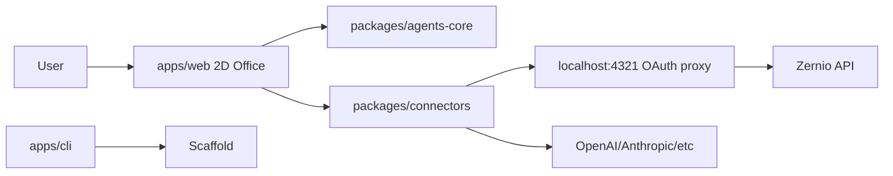

# Architecture

## C4 (Mermaid)



## Folder tree
```
apps/web, apps/cli
packages/agents-core, packages/connectors
docs (VitePress)
.github/workflows
```

## Decisions (ADR)
- ADR-001: Phaser 3 for 2D rendering (mature, sprite support).
- ADR-002: Zustand for state (lightweight).
- ADR-003: Keytar for secure credential storage (OS keychain).
- ADR-004: Mock probes in v0.1 with TODO for real adapters.
```
