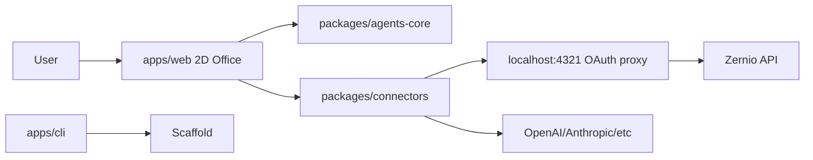

# Architecture

## C4 (Mermaid)



## Folder tree

```
apps/web, apps/cli
packages/agents-core, packages/connectors
docs (VitePress)
.github/workflows
```

## Decisions (ADR)

- ADR-001: Phaser 3 for 2D rendering (mature, sprite support).
- ADR-002: Zustand for state (lightweight).
- ADR-003: Keytar for secure credential storage (OS keychain).
- ADR-004: Mock probes in v0.1 with TODO for real adapters.
- ADR-005: Round "mesa redonda" office scene — a circular table with a
  central winner board ("Ganador de la semana") instead of desktop desks.
  `CircularOfficeScene` renders agents on a ring around the table; triggered
  via the round-table button on the HUD.
- ADR-006: Stainless, brand-locked design tokens in `packages/ui/tokens.json`
  (ink #111827, paper #F5F1E8, warm accent #FF5C35) — no brand color is
  hardcoded in UI code.

## Runtime data flow

- `apps/web` mounts a Phaser game (`OfficeScene` + `CircularOfficeScene`) and a
  React overlay (dialogue, panel, i18n, encrypted store).
- `packages/agents-core` drives the conversational engine (YAML agents,
  `DialogueEngine`, XState-free state machine).
- `packages/connectors` exposes API-key probes, MCP discovery, skills
  discovery/install, Zernio OAuth (local `:4321` proxy), and the `.env`
  exporter.
- `apps/cli` scaffolds the repo via `degit` + `pnpm install` and exposes the
  `fabrica` CLI (`init`, `doctor`, `upgrade`, `export-env`, `validate-connectors`).
